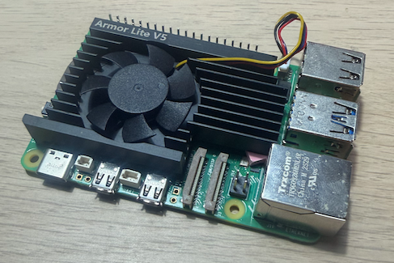
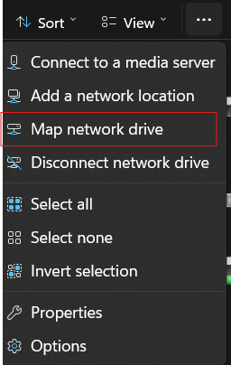

# Create your own home NAS
This tutorial will show you how to create your own home NAS that you can use to store your files.

## Is a NAS storage solution right for me?
To decide if a NAS storage solution is the right thing for you, you first have to question why you need a NAS over other
storage solutions such as a third-party cloud storage provider like OneDrive or iCloud. 

### Advantages
| Cloud Storage                                             | Home NAS                                                                |
|-----------------------------------------------------------|-------------------------------------------------------------------------|
| Large storage options available                           | More granular control over security                                     |
| Can connect from any computer with an internet connection | Can add very large hard drives to your setup without a high monthly fee |
| Dont have to worry about hosting                          | Do not have to pay for an extra susbcription to a cloud storage service |

### Disadvantages
| Cloud Storage                                                               | Home NAS                                                                                                                               |
|-----------------------------------------------------------------------------|----------------------------------------------------------------------------------------------------------------------------------------|
| Monthly subscription required                                               | You are responsible for the security                                                                                                   |
| Your data is stored in a companies servers where they are at risk of attack | Requries an extra device in your house to always be on                                                                                 |
| Trusting third-party company data encryption standards and rules            | Requies more setup                                                                                                                     |
|                                                                             | You are responsible for backups of the contents ON the NAS                                                                             |
|                                                                             | Can only access the drive on your HOME network <br/>unless you install software to allow access from remote locations (e.g. Tailscale) |

## Required hardware
This setup requires a Raspberry Pi (preferably 3 or higher), a SATA hard drive and a USB to SATA converter.

## Initial setup
For this setup I will be using a Raspberry Pi 5 with a 2TB hard drive. 



The USB to SATA adapter you choose depends on what size of hard drive you choose. A larger 3.5"
SATA hard drive requires more power compared to a 2.5" hard drive. Thus it would be beneficial to purchase a SATA adapter which has its own power source. If you are choosing
a smaller 2.5" hard drive, you can use a direct adapter as there isn't an extra power need.

SSDs dont require as much power as a HDD, so you will be fine using a direct adapter.

Since we are hosting the storage from an external storage device, we don't need to buy a large SD card. For my setup, I will use a 64gb SD card for the OS image.

For reliable speeds, you should connect your Raspberry Pi/computer to your home network/Router via Ethernet.

First you need to download an operating system on your Raspberry Pi. I am going to use the Raspberry Pi OS. Download the OS imager from the Raspberry Pi website <a href="https://www.raspberrypi.com/software/">here</a>.

This software allows you to create an OS image directly onto your SD card.

## Setup OS
After imaging the OS, find a permanent place for the Raspberry Pi to live (preferably somewhere with good ventilation and has a route for a cable to run from the RPi to the Router).

Set up the RPi, connecting power and a keyboard/mouse temporarily and follow on screen OS setup instructions until you reach the desktop.

Take note of the Username and Password you chose when setting up the OS. (You must have a password!)

## Enable SSH
For you to easily control the RPi, you need to enable SSH so you can control the computer from the terminal at any other computer connected to the same network.

The setup process is different for every different OS, but the process for Raspberry Pi OS is as shown below:

1. Open the terminal and enter ```sudo raspi-config```
2. Navigate to <i>Interface Options</i> and press enter
3. Find <i>SSH</i> then press enter - following on-screen instructions to enable SSH.
4. Exit raspi-config

## Set up the external storage device
If the storage drive isn't connected to your RPi yet, connect it now.

We need to format and mount our external device.

1. In the terminal, type ```sudo lsblk``` (This shows all the storage devices connected to your RPi).
2. Identify what label your storage device is by looking at the storage capacity of each connected drive. In my case, it is sdb.
3. We now need to format the drive. Enter ```sudo fdisk /dev/sdb``` replacing <b>sdb</b> with whichever label your drive was under.

(You can double-check that you have the right drive by doing ```sudo fdisk -l```)

The next thing is to delete any existing partitions. Type ```d``` into the prompt repeatedly until all partitions are deleted.

You can now create your new partitions. In my case I am creating two partitions (one of size 800gb and 1tb).

For me, I typed >>> ```n``` > ```1``` > Enter key for default first sector > ```+800G``` 

For the second 1tb partition >>> ```n``` > ```2``` > Enter key for default first sector > Enter for default last sector (meaning the rest of the drive)

To write these new changes to the disk, type ```w``` 

<b>YOU MUST ENSURE THAT YOU HAVE FORMATTED THE CORRECT DRIVE BEFORE WRITING AS THIS STEP CANNOT BE UNDONE</b>

We now need to add a file system for each of the partitions. The ```ext4``` file system is readable by Windows, macOS and linux, so I will format it to ext4.

Type ```sudo mkfs.ext4 /dev/PARTITION``` and allow it to add the file system. In my case for sdb1 (partition 1) I will enter ```sudo mkfs.ext4 /dev/sdb1```.

This command must be repeated for each partition on your shared drive.

## Install and setup samba
Samba allows linux machines to share drives and services (such as printers) over a network. We first need to install it.

Return back to the command line through Ctrl+C.

Type ```sudo apt install samba``` to install samba.

We now need to mount the drive partitions that we created earlier. This is because samba needs a mount location so it knows what 
folder to share over the network. For our use case on linux, we will use the ~/mnt folder.

Type ```lsblk``` to identify the specific drive partition you want to share (eg. sda2,sdb1...).

Once that is done we need to create a new folder in /mnt that the partition will be mounted to.

Navigate to the mount folder on the command line by doing ```cd ~/mnt``` (note that on some machines you will have to put ```sudo``` at
the beginning of the command for admin permissions.)

Make a new folder in /mnt by typing ```mkdir FOLDER_NAME```. I will call mine virtualNAS (```mkdir NAS```).

We need to mount the partition of the disk to this drive so that samba can access the partition. Type ```sudo mount /dev/PARTITION /mnt/NAS``` replacing <b>PARTITION</b>
and <b>virtualNAS</b> with the name of your partition (eg. sdb1) and folder you created in the step above.

If using the ```mount``` command, linux will only keep the drive mounted until the next reboot. To make this mount permanent, we have to edit /etc/fstab.

The UUID of the partition is needed for this part. START HERE


We now need to create a username and password that will be used when logging onto the network share from another computer.

I am going to make the username ```NASowner```.

Type into the command line ```sudo useradd NASowner``` then enter.

To create a password for this new user type ```sudo passwd NASowner``` which will then prompt you to create a new password.

After creating this user we need to give it access to the folder in /mnt we created. This can be done by typing ```sudo chown -R NASowner:NASowner /mnt/NAS```.

Now we need to tell samba what partition we want to share over the network. Type ```sudo nano /etc/samba/smb.conf``` which will open the file smb.conf in the nano text editor.

Samba allows for setting of a few parameters regarding the permissions of the hosted partition.

Scroll to the bottom of the page in samba and enter this:  


```
[NAS]
   comment = NAS drive
   path = /mnt/NAS
   browsable = yes
   writable = yes
   valid users = NASowner
   force user = NASowner
   read only = no
   create mask 0770
   directory mask = 0770
```

Most of these parameters are self-explanatory. Change these variables according to your desired setup.

valid users Is this list of all users that are allowed to read and write to the shared drive. The force user catagory dictates the account that all files on the drive will be owned by.

Once you are happy with your setup, press ctrl+o to save the config and then ctrl+x to exit the nano editor.

We now need to restart samba and continue with the next step of connecting to our new server.

## Connecting to the new NAS
The process of connecting to the remote network storage share differs depending on what operating system you are using.

#### Windows 10/11
Open file explorer and navigate to the "This PC" tab in the sidebar. Select the three dots and press "Map network drive".



You will then be prompted to enter the drive letter and the folder where it is located. You can choose any letter. When
you choose the folder location type ```\\NAS_IP\NAME_OF_SAMBA_SHARE```. As an example, my samba share name from
this tutorial is called ```NAS```.

(If you are unsure of what your tailscale IP is, it is listed on the tailscale machines tab. The IP you are looking for is the one of the remote server.)

Select ```Connect using different credentials``` as we will be connecting with the username and password created earlier in the tutorial.

After pressing next, enter your newly created credentials and connect.


